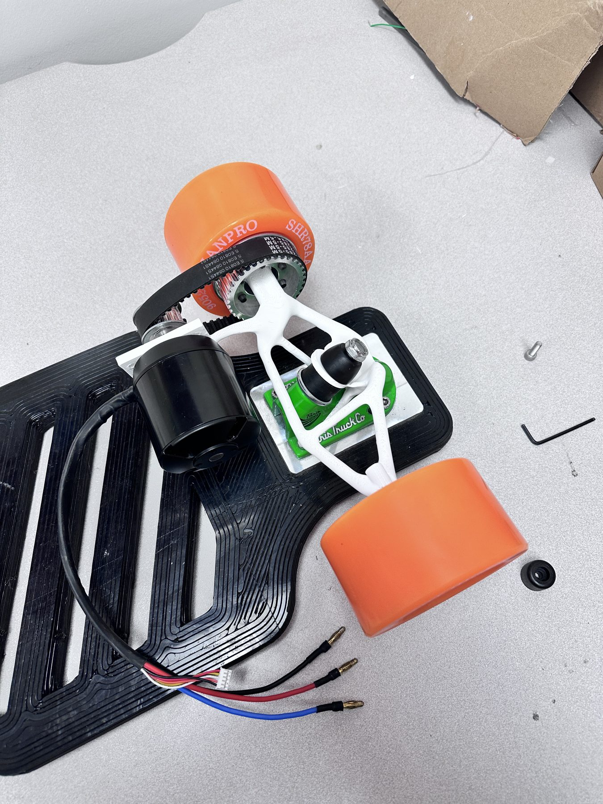
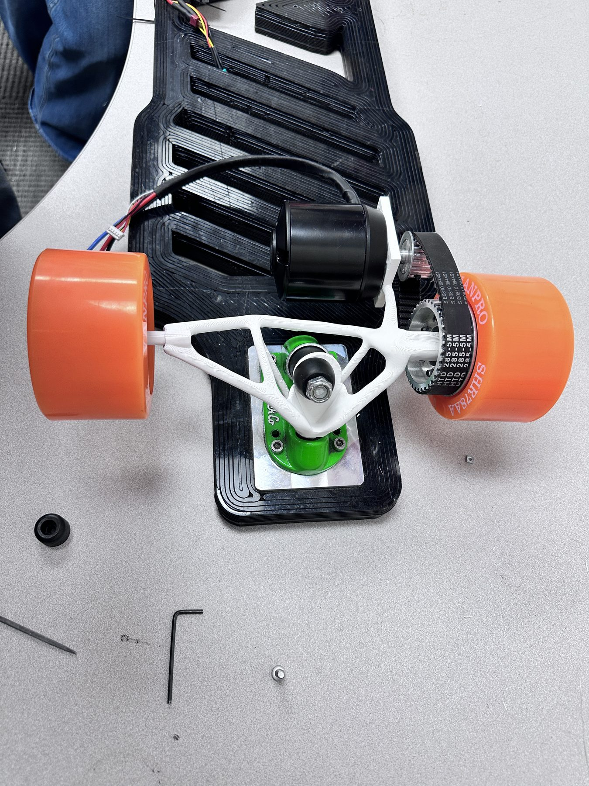
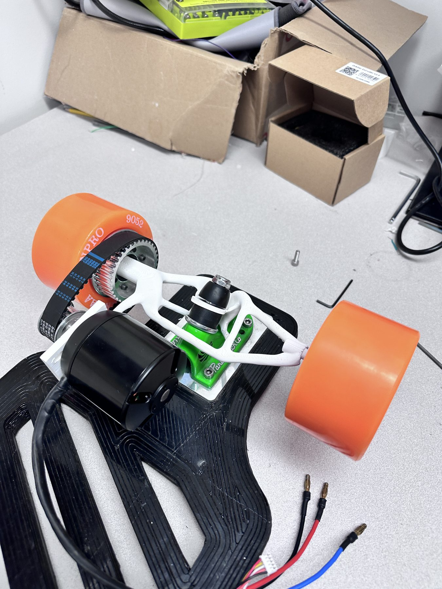
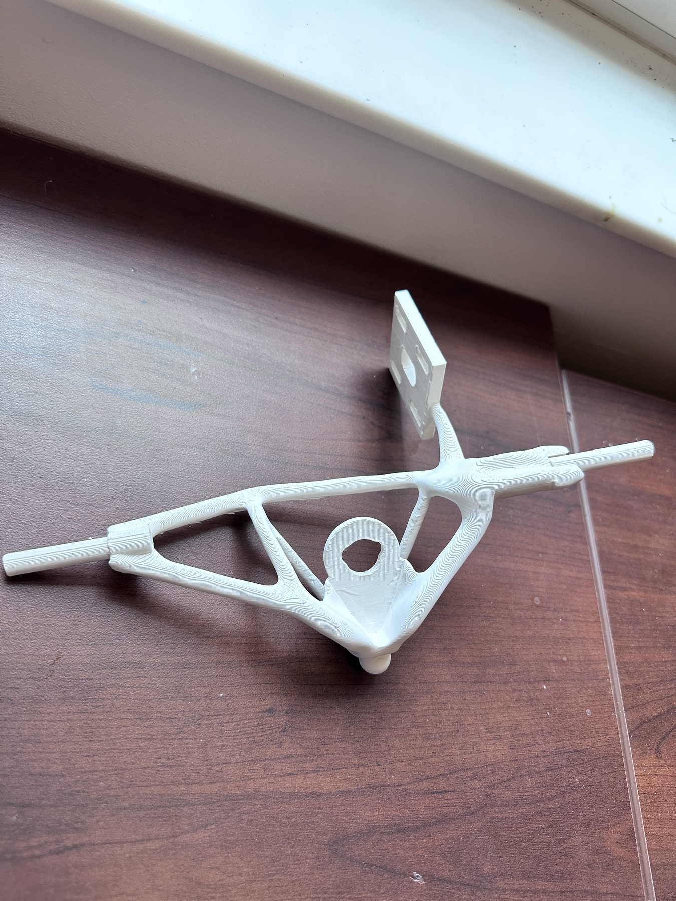
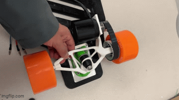
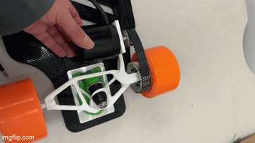

## Overview

Lightweight skateboard truck hanger with an integrated brushless DC motor mount, combining what are normally separate truck and motor mount components into one optimized structure. Critical interfaces were preserved: axle bearing seats, pivot cup, kingpin clearance, and motor mounting features. The final part was assembled with the deck, motor, belt, pulley, and wheels to verify fit and clearance.

## Objectives

- Minimize hanger and motor mount mass
- Maintain wheel bearing seat geometry
- Preserve pivot cup and kingpin function
- Maintain motor bolt and shaft clearance
- Maintain belt and pulley clearance
- Compare outcomes across metal materials

## Study setup

Objective: minimize mass at a minimum safety factor of 2. Manufacturing method unrestricted, so outcomes are not limited by machining constraints.

**Preserve geometry**

- Axle ends at the wheel bearing seats
- Pivot cup interface
- Motor mounting holes and shaft clearance hole
- Kingpin and bushing region
- Critical assembly contact surfaces

**Obstacle geometry**

- Wheel, belt path, and pulley clearance
- Kingpin and bushing installation clearance
- Allen key and bolt access

Obstacles keep the hanger free to rotate about the pivot and kingpin without contacting the bushings or motor system.

## Load cases

Loads represent riding, turning, braking, motor operation, and impact.

| Load | Magnitude | Location | Represents |
|---|---:|---|---|
| Ground reaction | 50 N | Preserved bushing geometry | Ground reaction through the truck |
| Motor weight moment | 10 N·m | Preserved motor mount | Motor weight and torsion on the mount plate |
| Motor belt force | 9 N | Motor mount, toward pulley | Belt tension from driving the wheel |
| Wheel bearing reaction | 400 N | Wheel and axle bearing interface | Distributed wheel loads through the bearing |
| Rider weight | 100 N | Hanger tip at deck attachment | Rider load on the center of the hanger |
| Motor contact pressure | 5 N | Motor contact surface | Normal force from motor to mount plate |
| Center reaction | 50 N | Back of the hanger center | Reaction from bushings and deck |
| Axle bearing load | 100 N | Preserved axles | Wheel forces into the axle |
| Remote moment | 9 N·m | Between mount plate and axles | Belt-driven torque on the axle and plate |

## Fusion 360 models

**Final truck model**

<iframe src="https://vanderbilt643.autodesk360.com/shares/public/SH90d2dQT28d5b6028117bade36171b9257d?mode=embed" width="100%" height="480" allowfullscreen="true" webkitallowfullscreen="true" mozallowfullscreen="true" frameborder="0" title="Final truck model" style="display:block;border:0;"></iframe>

**AlSi10Mg aluminum outcome**

<iframe src="https://vanderbilt643.autodesk360.com/shares/public/SH90d2dQT28d5b60281111a247b21f0b0aac?mode=embed" width="100%" height="480" allowfullscreen="true" webkitallowfullscreen="true" mozallowfullscreen="true" frameborder="0" title="Aluminum generative design model" style="display:block;border:0;"></iframe>

**Original model**

<iframe src="https://vanderbilt643.autodesk360.com/shares/public/SH90d2dQT28d5b6028112772f9c1c3e640cb?mode=embed" width="100%" height="480" allowfullscreen="true" webkitallowfullscreen="true" mozallowfullscreen="true" frameborder="0" title="Original truck model" style="display:block;border:0;"></iframe>

## Material comparison

| | AlSi10Mg aluminum | 17-4 PH stainless steel |
|---|---|---|
| Generated geometry | Thicker, bulkier members | Thinner, more compact members |
| Driver | Lower density, lower strength and stiffness | Higher strength and stiffness |
| Trade-off | Lighter load paths, larger section | Compact section, higher density |
| Outcome | Comparison study | Selected for the printed final model |

Across all outcomes and constraint changes, material properties set the character of the generated geometry: lower-density aluminum spreads load over larger members, while stronger steel concentrates it in slimmer ones.

## Assembly and motion checks

**Turning clearance:** assembly rotated through steering motion to confirm pivot and kingpin clearance.

**Drivetrain clearance:** motor, pulley, belt, and wheel rotated to confirm no contact with the hanger.

## Discussion

**Applications.** Generative design produces structures that follow a part's primary load paths, reducing design time and mass. Examples include a [NASA vapor collection device produced by Protolabs](https://www.youtube.com/watch?v=S2aBP-dLg5w), built and shipped in hours, and [Lockheed Martin's laser powder bed fusion components](https://www.lockheedmartin.com/en-us/news/features/2026/Accelerating-Operational-Readiness-with-Laser-Powder-Bed-Fusion-Additive-Manufacturing.html) for platforms including the UH-60M Black Hawk and Precision Strike Missile, with tested applications showing 15–20% weight reduction and 10–15% better heat dissipation.

**Load case quality.** The solver optimizes only around the loads it is given. Missing loads can remove material from regions that need strength; oversized or misplaced loads produce heavy designs, as seen in early iterations of this project. Loads here were selected from real use: rider weight, axle bearing loads, and belt tension.

**Limitations.**

- Outcomes require cleanup, smoothing, and interpretation before becoming usable parts
- Obstacle geometry can unintentionally disconnect preserve geometry from the generated body; unnoticed, this wastes print material and time
- Some outcomes left unwanted material at the axles or were not structurally sound
- Correct preserve geometry, obstacles, constraints, and loads still depend on engineering judgment

**Best use.** Cost-sensitive and mass-critical applications, such as aerospace parts designed to tight safety factors, where targeting a specific mass or minimum thickness shortens the path to a manufacturable design.
