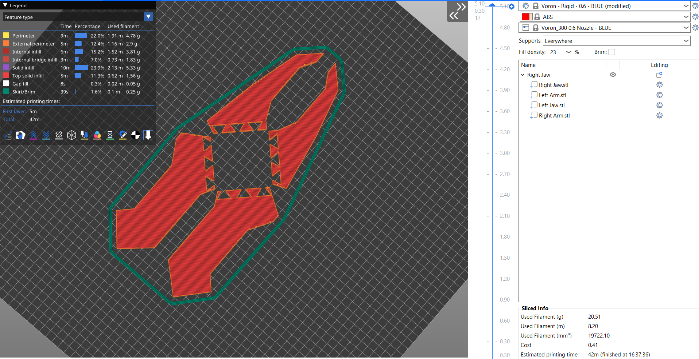
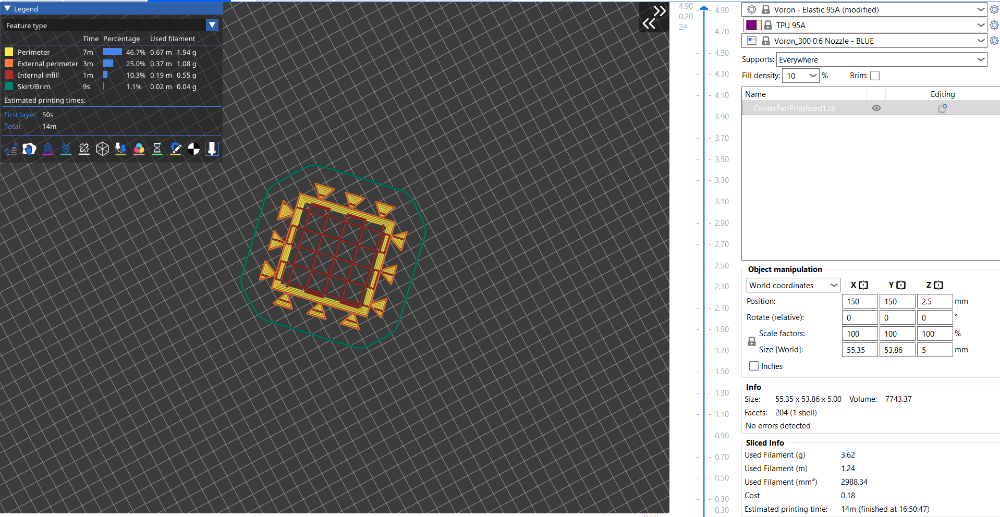

## Design

Print-in-place and multi-material techniques are used across aerospace and automotive manufacturing, for example in [prototype bearings](https://core-electronics.com.au/guides/print-in-place-tips/) and [aerospace intakes, ducts, and fixtures](https://www.bakerindustriesinc.com/blog/design-freedom-unleashed-how-3d-printing-enables-complex-aerospace-components/). These pliers apply the technique in simplified form.

- **Arms and jaws:** ABS for rigidity; 85.05 mm jaw length
- **Center section:** TPU 95A, acting as the spring that reopens the pliers after each squeeze
- **ABS–TPU interface:** dovetail form-fit joint rather than a co-printed bond. Multi-material bonding depends on surface chemistry and differential shrinkage, and alternating filaments within each layer adds print time and failure risk.

## Slicer settings

The TPU center relies on its infill deforming as a spring, so the default solid shells are removed to expose it.

| Setting | TPU center | ABS arms and jaws |
|---|---|---|
| Top and bottom horizontal shells | 3 → 0 | Default |
| Perimeters | 3 | Default |
| Infill pattern | Rectilinear (default gyroid replaced) | Default |
| Infill density | 10% | 23% |

Rectilinear infill buckles predictably under load and springs back, giving the return force. Other low densities also work, provided the TPU still recovers. The 23% ABS infill keeps the arms stiff enough to deform the TPU without failing.

<video width="700" autoplay loop muted playsinline>
  <source src="{{ '/assets/img/IMG_2523-ezgif.com-video-to-gif-converter.mp4' | relative_url }}" type="video/mp4">
</video>

Pliers gripping a resistor.

## CAD model

<iframe src="https://vanderbilt643.autodesk360.com/shares/public/SH90d2dQT28d5b6028115441302eab5825b7?mode=embed" width="100%" height="480" allowfullscreen="true" webkitallowfullscreen="true" mozallowfullscreen="true" frameborder="0" title="Multi-material pliers CAD model" style="display:block;border:0;"></iframe>

## Final product


