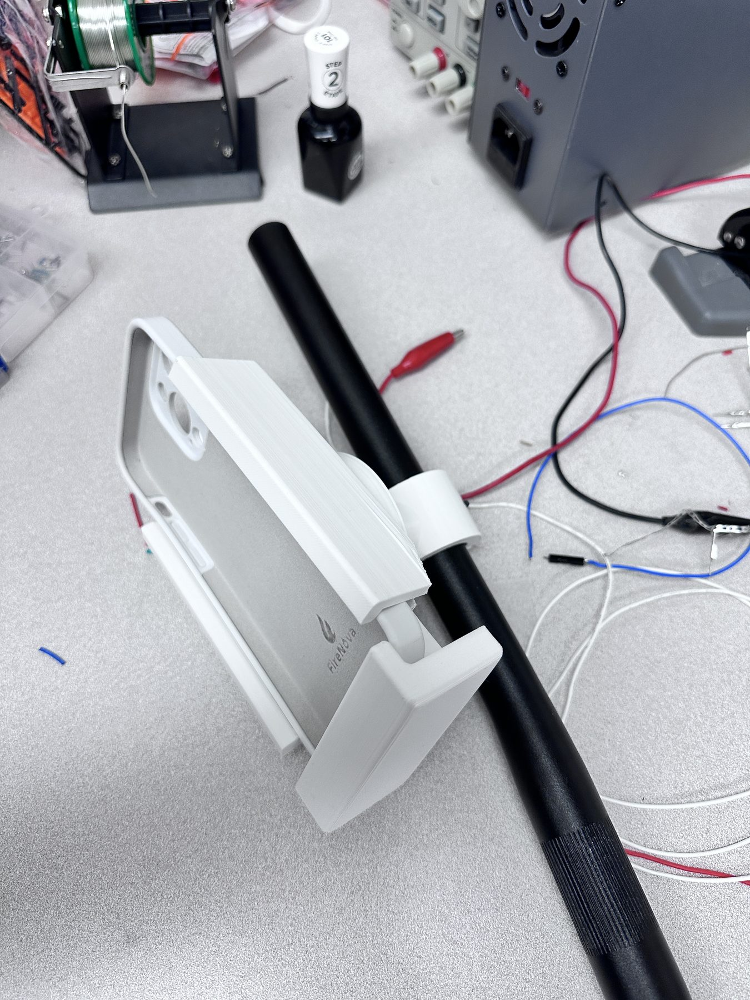
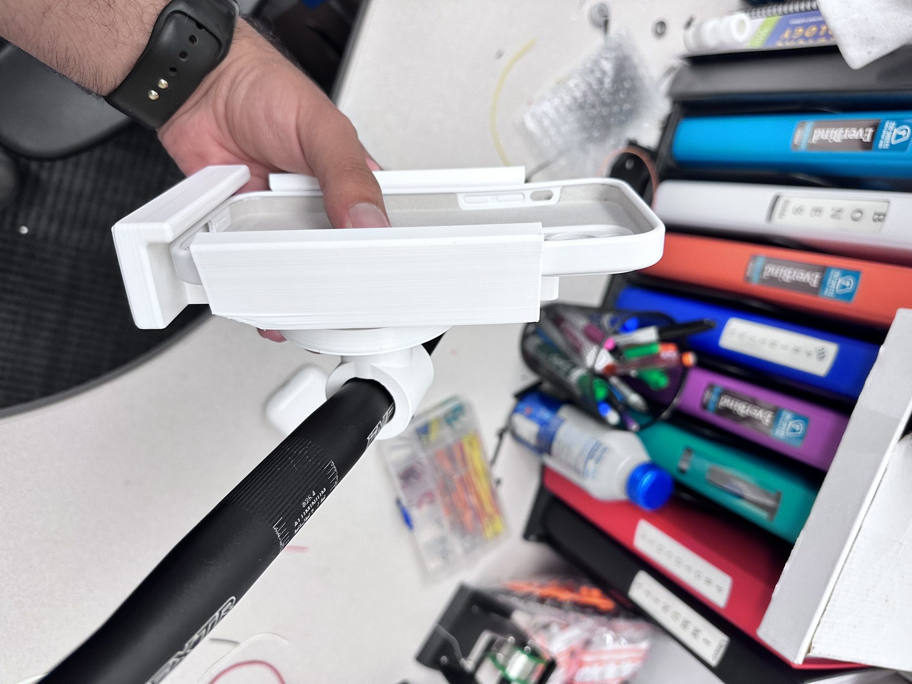
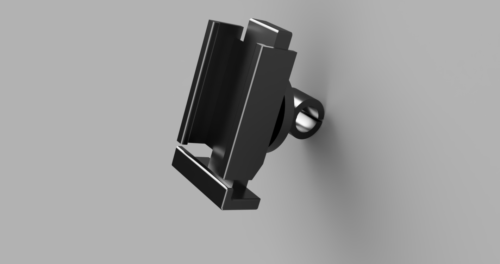
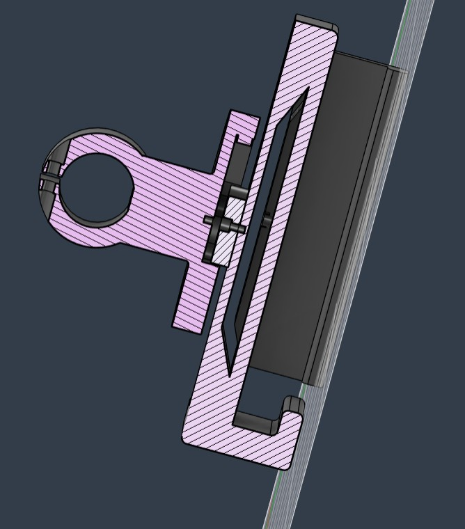
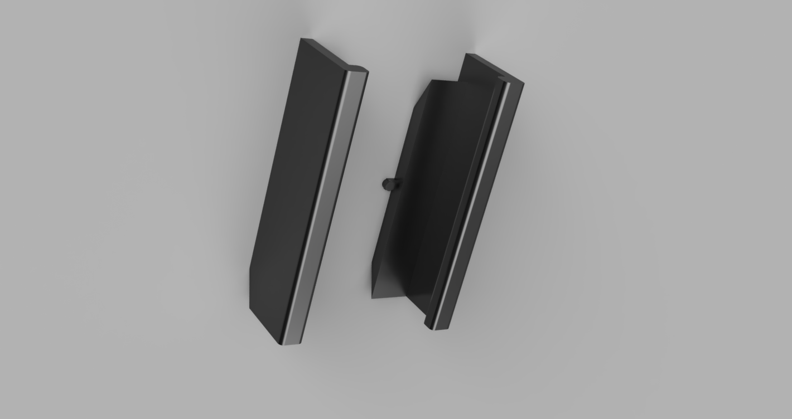
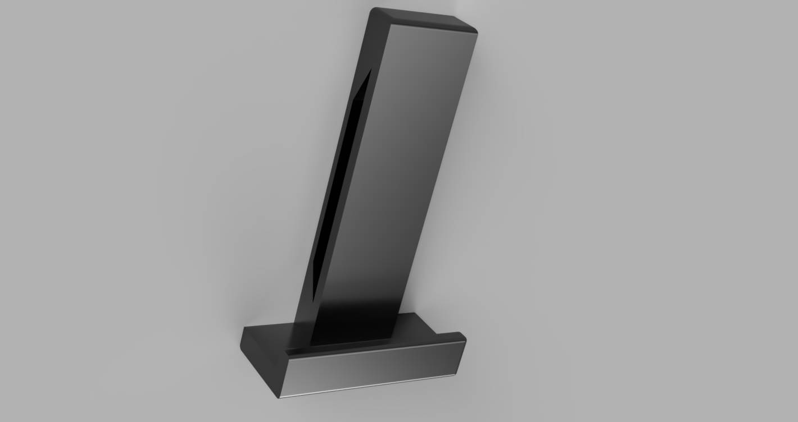
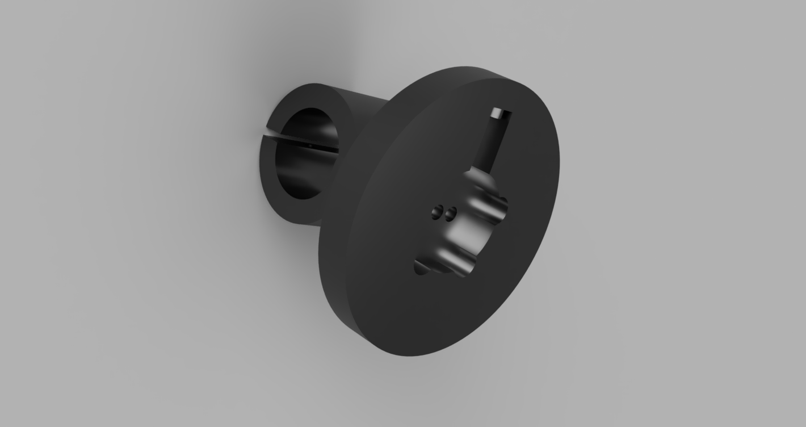
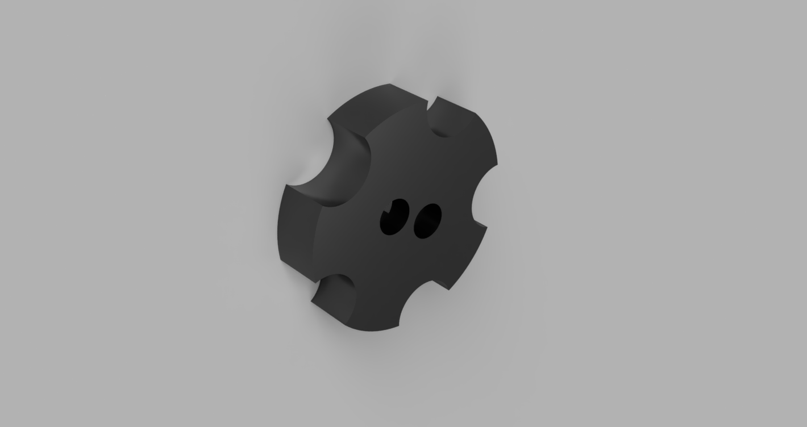

## Overview

Filament-printed bike phone mount designed with a top-down modeling approach.

**Requirements**

- Secure attachment to the handlebar
- Phone retention under vibration, across a range of phone sizes
- Tool-free rotation between portrait and landscape
- Practical to print and assemble with minimal hardware

## Top-down modeling

All components were modeled within a single assembly by projecting and offsetting shared geometry, rather than editing parts individually and updating the assembly. This sped up iteration and kept interfaces consistent, particularly the dovetail clamp offsets and the ball-detent interface.

## Detent mechanism

- **Gear:** carries the detent teeth; fixed to the phone mount
- **Housing:** holds the ball bearing and spring; jointed to the bike handle
- The ball seats in the gear teeth, allowing rotation between orientations while holding position under load

## Assembly

- Spring-loaded clamping jaws connected by an elastic spring, anchored by a tooth on the inner face of the base
- Detent gear on the back of the phone holder engages the ball and spring housing
- The bottom piece carries the detent housing and attaches to the bike
- Minimal screws; the assembly is held together by spring and ball preload

## Printing and tolerances

- PLA at 50% infill, chosen for fast iteration and functional strength; tested to hold a phone with all three jaws
- **Dovetail sliders:** 0.4 mm clearance for free sliding without a friction fit
- **Countersinks:** about 3.2 mm deep, keeping screw heads flush so the rigid bike joint meets the gear without added friction
- **Gear clearance:** accounts for print shrinkage and expansion and prevents binding during rotation

## CAD model

<iframe src="https://vanderbilt643.autodesk360.com/shares/public/SH90d2dQT28d5b602811be0c1d884ddf56cb?mode=embed" width="100%" height="480" allowfullscreen="true" webkitallowfullscreen="true" mozallowfullscreen="true" frameborder="0" title="Bike phone mount CAD model" style="display:block;border:0;"></iframe>

## Photos

<video width="700" autoplay loop muted playsinline>
  <source src="{{ '/assets/img/Phonemountgif-ezgif.com-video-to-gif-converter.mp4' | relative_url }}" type="video/mp4">
</video>

Rotation between portrait and landscape.

## Components

