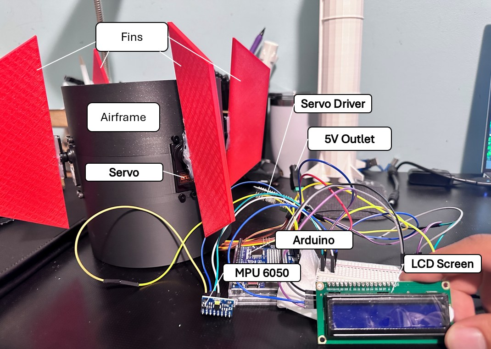
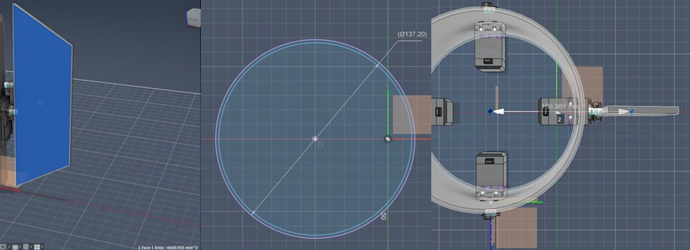

## Overview

Tabletop mechatronics demonstrator converting measured airframe orientation into fin deflection. An MPU-6050 IMU feeds an Arduino Uno R4, which estimates pitch and roll and commands four servo-actuated fins through a PCA9685 driver. A 3D-printed airframe carries the servos and fins; an I2C LCD displays live values. Scaled demonstrator only; not flight hardware.



```text
MPU-6050 IMU -> Arduino Uno R4 -> PCA9685 servo driver -> CN0023 servos -> 3D-printed fins
```

## Parts

| Part | Qty | Function |
|---|---:|---|
| Arduino Uno R4 WiFi | 1 | Reads the IMU, runs the control loop, updates the LCD, commands the servo driver |
| MPU-6050 GY-521 IMU | 1 | Acceleration and angular velocity for pitch and roll estimation |
| PCA9685 servo driver | 1 | PWM generation for four servos over I2C |
| CN0023 servos | 4 | Fin actuation |
| I2C 16×2 LCD | 1 | Live pitch, roll, servo angle, gain, deadband, range, and trim |
| External 5 V, 10 A supply | 1 | Servo power, isolated from the Arduino |
| 3D-printed airframe section | 1 | Servo mounting; represents the rocket body |
| 3D-printed fins | 4 | Control surfaces |
| Servo horns | 4 | Fin-to-servo connection |

## Mechanical design

- Four fins in a cross layout around a 137.2 mm diameter printed airframe
- Fins bonded to the servo horns to prevent slip, so commanded servo angle matches physical fin angle
- Fin face area: 6,619.9 mm²
- Airframe center of mass to fin center: 106.96 mm
- Airframe and fins modeled in Fusion 360

<!-- Photo not uploaded yet; add it to assets/img/rocket-fin-control/ and remove this comment wrapper to show it:
 -->



## Electronics

- MPU-6050, LCD, and PCA9685 share the I2C bus (A4 = SDA, A5 = SCL)
- MPU-6050 powered at 3.3 V; LCD and PCA9685 logic at 5 V
- Servos powered by an external 5 V, 10 A supply, since the Arduino cannot source current for four servos moving at once
- Common ground between the Arduino and the servo supply

<!-- Photo not uploaded yet; add it to assets/img/rocket-fin-control/ and remove this comment wrapper to show it:
 -->

| PCA9685 channel | Fin | Axis |
|---|---|---|
| 0 | Top | Pitch |
| 1 | Right | Roll |
| 2 | Bottom | Pitch |
| 3 | Left | Roll |

<!-- Photo not uploaded yet; add it to assets/img/rocket-fin-control/ and remove this comment wrapper to show it:
 -->

## Attitude estimation

The accelerometer provides a gravity-referenced tilt estimate that is accurate over time but noisy during motion. The gyroscope provides smooth short-term response but drifts as integration error accumulates. The two are combined with a complementary filter.

**Accelerometer tilt**

$$
\text{roll}_{\text{accel}} = \operatorname{atan2}(a_y,\ a_z)
$$

$$
\text{pitch}_{\text{accel}} = \operatorname{atan2}\left(-a_x,\ \sqrt{a_y^2 + a_z^2}\right)
$$

**Gyroscope integration**

$$
\text{roll}_{\text{gyro}} = \text{roll} + g_x \, \Delta t
$$

$$
\text{pitch}_{\text{gyro}} = \text{pitch} + g_y \, \Delta t
$$

**Complementary filter**

$$
\text{roll} = \alpha\left(\text{roll} + g_x \, \Delta t\right) + (1 - \alpha)\, \text{roll}_{\text{accel}}
$$

$$
\text{pitch} = \alpha\left(\text{pitch} + g_y \, \Delta t\right) + (1 - \alpha)\, \text{pitch}_{\text{accel}}
$$

| Symbol | Definition |
|---|---|
| $$a_x, a_y, a_z$$ | Measured acceleration along each axis |
| $$g_x, g_y$$ | Gyroscope rates for roll and pitch |
| $$\Delta t$$ | Time between readings |
| $$\alpha$$ | Filter weight, 0.97 |

With $$\alpha = 0.97$$, each update is weighted 97% toward the gyroscope prediction and 3% toward the accelerometer correction. A higher value gives smoother fin motion with slower drift correction; a lower value corrects drift faster at the cost of more noise.

## Calibration and filtering

- **Gyro bias:** 300 samples averaged at startup with the airframe held still; the bias is subtracted from all subsequent readings
- **Zeroing:** the current orientation can be set as level on command
- **Deadband:** angles within 1.2° of level are treated as zero to suppress twitch from sensor noise
- **Command smoothing:**

$$
\text{currentPitch} = 0.8\,(\text{currentPitch}) + 0.2\,(\text{measuredPitch})
$$

$$
\text{currentRoll} = 0.8\,(\text{currentRoll}) + 0.2\,(\text{measuredRoll})
$$

## Control law

Proportional control with gain $$K = 1.8$$ about a 90° servo center. Opposite fins deflect in opposite directions as correcting pairs. A 10° tilt produces an 18° fin correction.

$$
\text{top fin} = 90^\circ + K\theta \qquad \text{bottom fin} = 90^\circ - K\theta
$$

$$
\text{right fin} = 90^\circ + K\phi \qquad \text{left fin} = 90^\circ - K\phi
$$

where $$\theta$$ is pitch and $$\phi$$ is roll.

- Correction limited to ±40° from center
- Servo travel limited to 50°–130° to prevent mechanical binding
- Per-servo trim values straighten each fin at the commanded center

## Operator interface

- LCD cycles through pitch and roll, servo angles, gain and deadband, and range and trim
- Serial commands for zeroing, centering, debug output, and a servo sweep test, without reflashing

<!-- Photo not uploaded yet; add it to assets/img/rocket-fin-control/ and remove this comment wrapper to show it:
 -->

## Relation to flight systems

A flight system follows the same loop (measure motion, estimate attitude, compute correction, actuate surfaces) using flight-rated sensors such as accelerometers, gyroscopes, barometers, GPS, and magnetometers. Unlike this tabletop model, deflected fins produce aerodynamic force that depends on airspeed, fin geometry, and the positions of the center of pressure and center of mass:

$$
F = \tfrac{1}{2}\, \rho V^2 A\, C_L \qquad M = F L
$$

where $$\rho$$ is air density, $$V$$ airspeed, $$A$$ fin area, $$C_L$$ lift coefficient, and $$L$$ the distance from the center of mass to the fin center. This demonstrator covers the sensing, estimation, and actuation portion of that loop; it does not model aerodynamic loads.

## Testing

| Test | Result |
|---|---|
| Servo sweep | PCA9685 and all four servos operational |
| LCD | Display functional over I2C |
| IMU connection | MPU-6050 detected at I2C address 0x68 |
| IMU motion | Pitch and roll respond to tilt |
| Servo response | Fins deflect in response to IMU motion |
| Zeroing | Current orientation sets as level |
| Power | External 5 V supply drives all servos |

## Lessons learned

- Multiple servos require external power and a shared ground
- Raw IMU data requires filtering before use in control
- Gyroscope response is smooth but requires accelerometer correction for drift
- Slip between the servo horn and fin degrades control response
- Gain, deadband, trim, and servo limits determine how the physical system behaves
- LCD and serial feedback significantly shorten debugging
