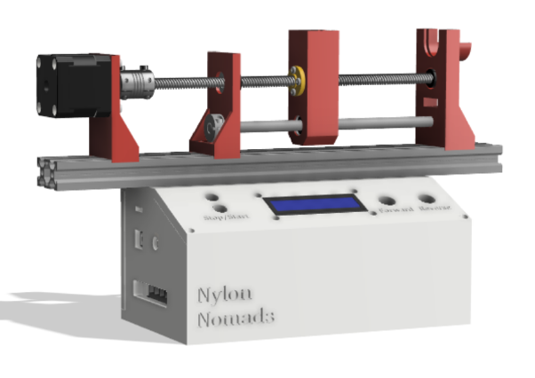

## Overview

Syringe pumps deliver precise fluid volumes across a wide range of flow rates and are used in medical, laboratory, and microfluidics settings. Commercial units often cost several hundred dollars, even at entry level. This low-cost design uses 3D-printed components and Arduino-based control to replicate the core functions of a commercial pump.

## Mechanical design

- NEMA 17 stepper drives an 8 mm lead screw through a flexible coupler
- Carriage rides on a smooth rod with a linear bearing and pushes the plunger
- Carriage and end-support slots accept both 10 mL and 20 mL syringes; only the code changes between sizes
- Enclosure iterated in Fusion 360 to correct misalignment and reduce carriage vibration

## Controls and interface

- **Latching button:** toggles running and paused
- **Momentary buttons:** jog the carriage forward or reverse while paused, for priming and adjustment
- **Limit switch:** detects an empty syringe at end of travel and stops the motor
- **Tri-color LED:** green running, yellow paused, red empty

## Electronics protection

- Electronics mounted beneath the main body, with no live parts exposed in normal use
- Enclosure shields the Arduino, driver, and wiring from splashes
- Heat shrink on exposed wires and solder joints

## Firmware

- Arduino Uno with the AccelStepper library driving a stepper driver
- Converts the requested flow rate (mL/min) to a step rate (steps/s) using the syringe's inner diameter and the lead screw pitch
- 1/16 microstepping for smooth, low-vibration motion at low flow rates
- Software-debounced inputs

[Code repository](https://github.com/Markothyy/Syringe-Pump-Project-Code/tree/main)

## Operating limits

| Parameter | 10 mL syringe | 20 mL syringe |
|---|---:|---:|
| Maximum flow rate (1,000 steps/s) | 6.54 mL/min | 10.08 mL/min |
| Minimum output (one step) | 0.109 μL | 0.168 μL |

## Operation

1. Load the syringe in the carriage and align it.
2. Enter the syringe size, total volume, and flow rate in the program.
3. Connect power to the Arduino, stepper driver, and motor.
4. While paused (yellow LED), hold Forward or Reverse to jog the carriage.
5. Press Start/Stop to run to completion or pause.

## Bill of materials

| Off-the-shelf components | Qty |
| --- | ---: |
| Arduino Uno | 1 |
| Stepper motor driver module | 1 |
| NEMA 17 stepper motor | 1 |
| Mean Well RT-65D power supply | 1 |
| 8 × 8 × 250 mm lead screw | 1 |
| 8 × 8 mm brass nut | 1 |
| 5 mm to 8 mm flexible coupler | 1 |
| 8 × 200 mm linear rod | 1 |
| 8 mm linear bearing | 1 |
| 8 mm shaft collar | 4 |
| Flanged ball bearing | 2 |
| V-slot 20 × 40 × 350 aluminum extrusion | 1 |
| Limit switch | 1 |
| Tri-color RGB LED | 1 |
| Latching button | 1 |
| Momentary button | 1 |
| Potentiometer | 1 |
| Breadboard | 1 |
| M3 × 0.5 screws | 17 |
| M3 heat-set inserts | 8 |
| M3 × 10 screws | 6 |
| M3 × 8 thread-forming screws | 4 |
| M3 × 0.5 socket head screws | 2 |
| M4 × 0.7 cup-point set screws | 2 |
| M5 T-nuts | 6 |
| M5 × 8 bolts | 6 |

| 3D-printed components | Qty |
| --- | ---: |
| Housing panels | 5 |
| Motor mounting plate | 1 |
| Carriage | 1 |
| Simple end support | 1 |
| Syringe end support | 1 |

## CAD model

  <iframe src="https://vanderbilt643.autodesk360.com/shares/public/SH90d2dQT28d5b6028113474eb8b44f17749?mode=embed" width="100%" height="480" allowfullscreen="true" webkitallowfullscreen="true" mozallowfullscreen="true" frameborder="0" title="Syringe pump CAD model" style="display:block;border:0;"></iframe>


