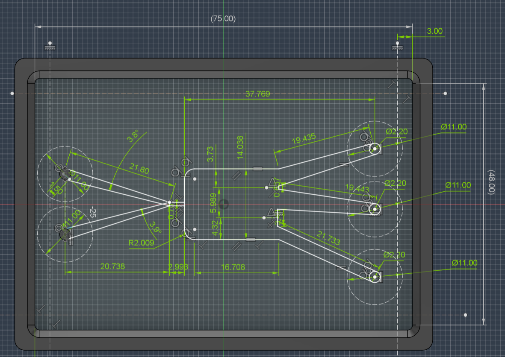
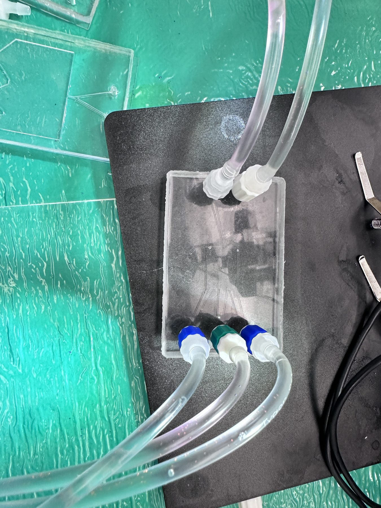
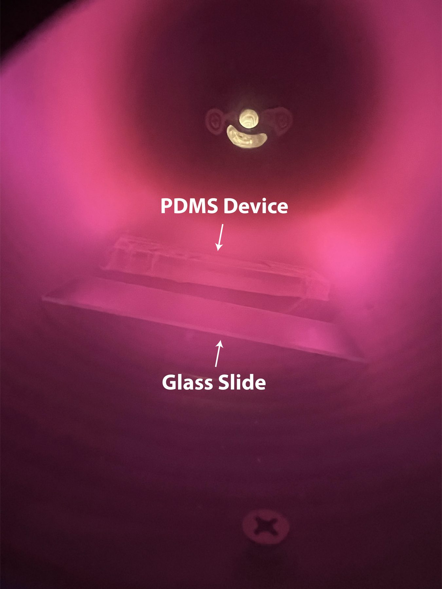
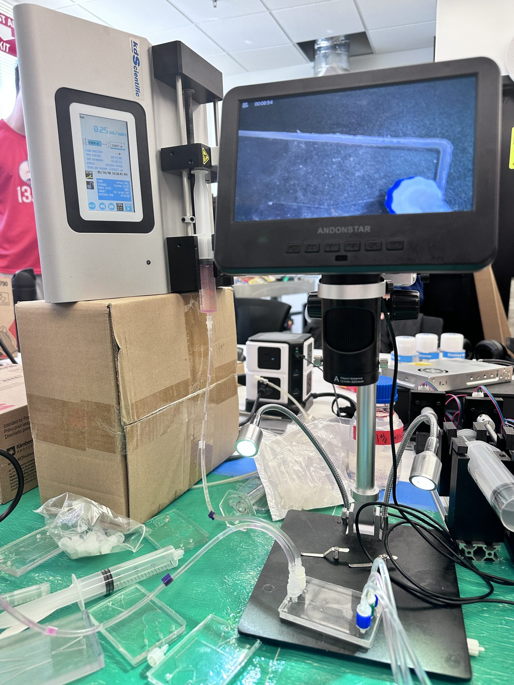

## Principle

Pinch flow fractionation (PFF) sorts particles by size using flow alone. Particles are pressed against one wall in a narrow pinch channel, where larger particles cannot approach the wall as closely as smaller ones. At the sudden expansion into the broad section, this small offset is amplified, directing each size class to its own outlet. [Primary source (PDF)](/assets/img/Asger.pdf)

**Applications**

- Sorting drug-carrying microparticles for targeted cancer treatment, where particle size determines transport through narrow vessels; PFF separates multiple size ranges in one continuous flow, unlike fixed-pore filtration
- Microplastic sorting for water quality testing
- Cell separation by size for blood diagnostics

## Design

Symmetric layout. The $$y_0$$ relation was used to predict each particle size's lateral position in the broad section after the pinch.

| Parameter | Value |
|---|---:|
| Pinch width, $$w_p$$ | 0.70 mm |
| Broad section width, $$w_b$$ | 15 mm |
| Small particle (150 μm) position from wall | 1.6 mm |
| Large particle (500 μm) position from wall | 5.4 mm |
| Small/large outlet boundary | 3.5 mm |
| Small particle outlet opening | 3.414 mm |
| Large particle outlet opening | 3.978 mm |
| Buffer outlet opening | 2.631 mm |
| Small particle outlet channel length | 19.435 mm |
| Large particle outlet channel length | 19.443 mm |
| Buffer outlet channel length | 21.733 mm |
| Outlet post diameter | 2.2 mm |
| Outlet post spacing (center to center) | ≥ 11 mm |

Flow fraction to each outlet is proportional to its opening width over the broad section width: 24.3% small, 28.3% large, and 18.7% buffer, with the remainder occupied by PDMS walls.

Outlets fan out at different angles to set relative channel resistance, keeping each stream in its intended outlet. The buffer outlet was intended to be the shortest and widest (lowest resistance); in the final design it was the longest of the three.

## Fabrication

1. Design the CAD within the printer's minimum feature size so channels print accurately and pass the particles.
2. Print the mold with its bottom surface flat on the build plate for a smooth sealing face.
3. Wash the mold and clear uncured resin from the channels, which would inhibit PDMS curing.
4. Coat the mold in parylene as a barrier between resin and PDMS.
5. Cast PDMS at the specified mix ratio.
6. Plasma treat the PDMS and glass slide, then bond to seal.

<iframe src="https://vanderbilt643.autodesk360.com/shares/public/SH90d2dQT28d5b6028112e76dd85967fe0f8?mode=embed" width="100%" height="480" allowfullscreen="true" webkitallowfullscreen="true" mozallowfullscreen="true" frameborder="0" title="Microfluidic device CAD model" style="display:block;border:0;"></iframe>

## Process selection

Form 3+ SLA resin printing was selected for:

- Minimum feature size small enough for PFF channel geometry, beyond FFF capability
- Watertight parts
- Smooth surface finish for a leak-free glass bond

## Testing

<iframe width="560" height="315" src="https://www.youtube.com/embed/Mm7DW0skopM" title="Device test video" frameborder="0" allow="accelerometer; autoplay; clipboard-write; encrypted-media; gyroscope; picture-in-picture; web-share" allowfullscreen style="display:block;width:100%;aspect-ratio:16/9;height:auto;border:0;"></iframe>

**Results.** Partial separation; most particles exited through the top channel.

- Broad section too short for particles to separate fully before the outlet boundaries
- Inlet walls made incoming flow less controlled entering the pinch
- The curved left edge of the broad section generated vortices that disrupted particle streamlines

## Improvements

- Lengthen the broad section
- Shorten the buffer path and lengthen the particle outlet channels to restore the intended resistance balance
- Add outlet channels of varying length for finer separation across more size ranges
- Add flow separators where the broad section meets the outlets

**Lower size limit.** Set by channel surface roughness, below which particles interact with the walls rather than following streamlines, and by the printer's minimum feature size, which bounds the pinch width.
